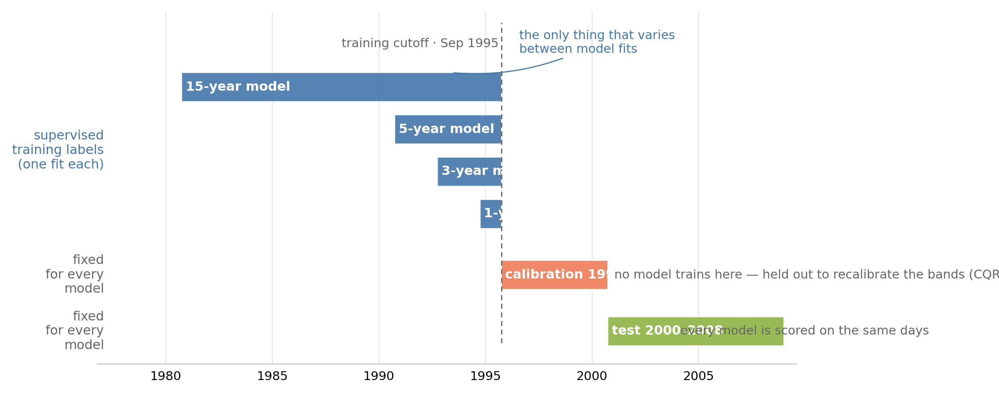
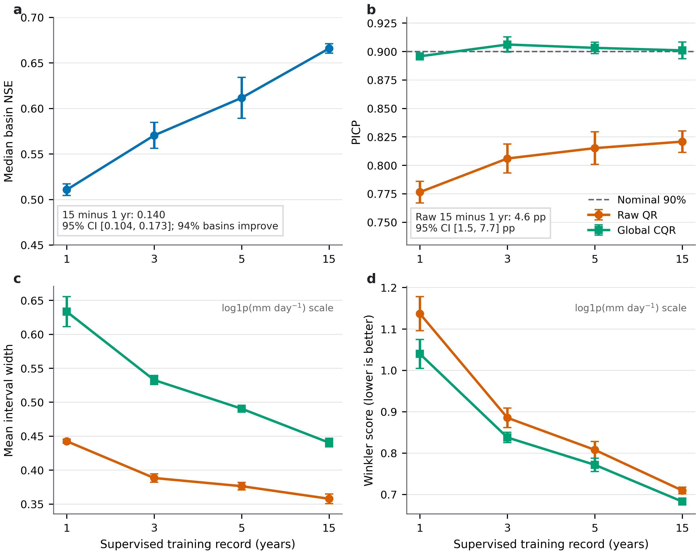
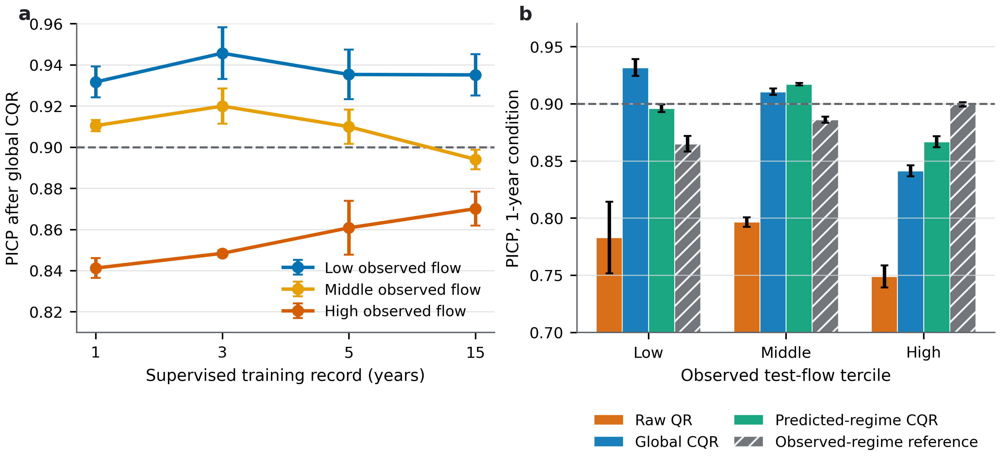

[English](README.md) | [简体中文](README.zh-CN.md)

# How supervised training-record length affects point skill and interval reliability in streamflow forecasting

Code and data pipeline for one question: how much supervised record does a
deep-learning streamflow forecaster actually need? The answer splits in two —
point skill keeps improving with longer records, while interval reliability
is fixed by calibration, not by more data.

## Approach



*One experiment, one variable: how many years of supervised training labels a
model sees. Four nested training windows all end at the same cutoff
(September 1995); the calibration window and test period that follow are
identical for every training length.*

**The model.** All experiments share one LSTM forecaster. Each day it reads
the previous 180 days of weather forcings plus static catchment attributes and
outputs a median streamflow forecast with a 0.05–0.95 band around it, trained
with a quantile (pinball) loss so the band is monotone by construction — the
upper bound can never drop below the median.

**The question.** Gauge records are expensive, and many basins have only a few
years of measurements. Does a deep-learning forecaster actually need the full
record, or does a short one suffice once its uncertainty bands are properly
calibrated? To answer this, the same model is trained four times per basin and
seed — on the last 1, 3, 5, or 15 years of labels before the September 1995
cutoff — while everything after the cutoff is never used for training.

**Making the bands honest.** Raw quantile bands from a neural network tend to
miss the nominal coverage, so every model is recalibrated with split
conformalized quantile regression (CQR): the held-out 1995–2000 window
measures how much the bands miss, and one constant correction widens (or
narrows) every interval by exactly that amount. A single global correction,
per-basin corrections, and corrections stratified by predicted flow level are
compared.

**Scale.** The primary set is 50 CAMELS-US basins with three training seeds
each; four disjoint 50-basin subsets replicate the endpoints on 250 unique
basins; a 671-basin benchmark compares eight uncertainty constructions; and 48
further fits probe architecture and protocol sensitivities (TCN, a standard
LSTM, a 13-quantile head, alternative training years, 365-day memory). Every
reported effect carries a bootstrap interval that resamples basins and HUC2
regions jointly.

## Key results

Two figures carry the headline story; the table lists the exact numbers behind
them.

**More supervised years buy accuracy but not valid intervals.** Median basin
NSE rises from 0.511 with one supervised year to 0.666 with fifteen, and
interval quality improves in step — yet raw 90% intervals remain below nominal
coverage at every training length. A longer record alone never makes
uncalibrated quantiles reliable.



*Supervised training-record length versus point skill and interval behavior on
the 50 primary basins: skill and coverage grow with the record, but raw
coverage stays under the nominal 0.90 until recalibration.*

**Calibration, not more data, is what fixes coverage.** Recalibrating on the
held-out 1995–2000 window with conformalized quantile regression restores
marginal coverage, and stratifying the correction on predicted flow restores
it inside each flow regime — the high predicted-flow group, where raw
intervals under-cover most, gains the most.



*Coverage by predicted-flow regime, before and after CQR recalibration on the
held-out calibration window.*

| Claim | Value |
|---|---|
| Median basin NSE, 1yr → 15yr | 0.511 → 0.666; paired median effect 0.140 [0.104, 0.173] |
| Raw pooled 90% coverage, 1yr → 15yr | 0.776 → 0.821; equal-basin effect +4.6 pp [1.5, 7.7], 72% of basins positive |
| One-year high **predicted**-flow coverage, global → stratified CQR | 0.832 → 0.882; gain +5.0 pp, positive under basin, HUC2 and synchronous-year resampling |
| Dense distribution scores (13-point IQS, log1p scale) | MDN 0.077511, Gaussian head 0.078314, noise-MC 0.081902; analytic Gaussian CRPS 0.080759 |
| Multi-level counterexample | 50% raw coverage 0.420 (1yr) vs 0.370 (15yr); TCN over-covers 0.930/0.922 |
| Matched 365-vs-180-day memory NSE effect | +0.0002 [-0.0022, 0.0070] short; +0.0072 [0.0002, 0.0125] long |

Score and point-skill directions generalize more consistently across resampling
schemes than raw coverage does; no universal raw-coverage gradient is claimed.

## Repository layout

```
src/                    library (imported, never run directly)
├─ evaluation/          scoring protocol: CQR radius, interval scores, IQS,
│                       analytic CRPS, group rules, empty-set projection
├─ models/              LSTM (LPU-Stream), standard LSTM, TCN
├─ heads/               dense distribution heads (MDN, Gaussian, noise)
├─ benchmark/           671-basin benchmark loaders
├─ corrections/         shared loaders for the corrected scarcity runs
├─ data/                CAMELS reading, preprocessing, normalization
└─ losses/              pinball loss, CQR calibrator

experiments/            runnable pipeline, one job per script
├─ prepare/             cache build/verify, data-chain and checkpoint audits
├─ train_primary/       main 12 fits, replication subsets, endpoint reruns
├─ train_benchmark/     the eight 671-basin constructions
├─ bias_correction/     median-bias-fix diagnostics
├─ train_sensitivity/   the 48 endpoint fits (queue-driven)
├─ evaluate/            coverage, scores, method comparison, calibration variants
├─ analyze/             summaries, paired effects, representativeness, curves
└─ figures/             all paper figures from the frozen tables

run_pipeline.py         single entry point; runs the stages in order
download_camels.py      fetches the CAMELS-US archive
tests/                  protocol unit tests (no dataset required; the three
                        recorded-table checks skip until results/ exists)
configs/                data configuration
```

Dependencies flow one way: `run_pipeline.py → experiments/* → src/*`. Scripts do
not import each other; shared logic lives in `src/`.

## Reproduce

```bash
pip install -r requirements.txt
python download_camels.py
python src/data/data_preprocessing.py
python run_pipeline.py --list      # inspect the stages
python run_pipeline.py --dry-run   # resolve every script path, run nothing
python run_pipeline.py             # full rerun (stages 2/3/5 need a CUDA GPU)
python -m pytest tests -q          # protocol tests
```

Reference environment: Python 3.11, PyTorch 2.11.0+cu128, RTX 5060 Ti (8 GB);
see `requirements-reference-cu128.txt`. Data, trained weights and per-sample
prediction arrays are not tracked; each stage regenerates its outputs under
`results/`. See [REPRODUCIBILITY.md](REPRODUCIBILITY.md) for the frozen
submission-round snapshot and its SHA-256 manifest.

## Citation and license

See [CITATION.cff](CITATION.cff) and [LICENSE](LICENSE). The earlier release
series has Zenodo concept DOI
[10.5281/zenodo.21256955](https://doi.org/10.5281/zenodo.21256955); that
concept record alone does not identify the revision round.
