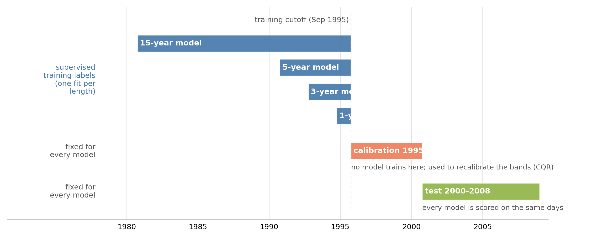
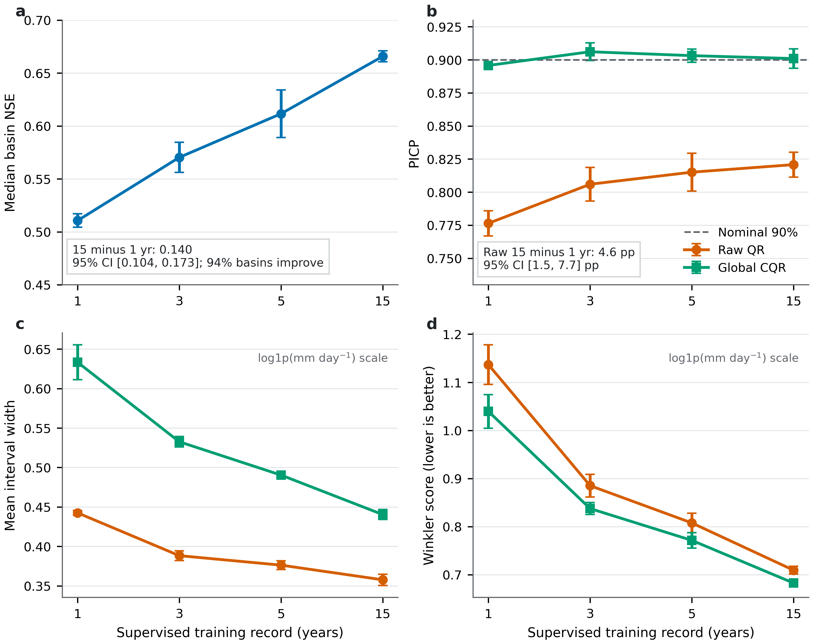
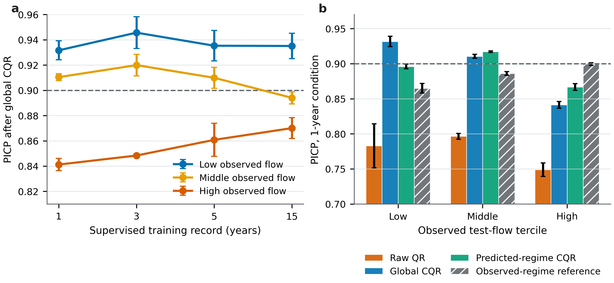

[English](README.md) · [简体中文](README.zh-CN.md)

# 训练记录长度、径流预测技巧与区间可靠性

论文 **《监督训练记录长度对径流预报点预测技巧与区间可靠性的影响》** 的代码仓库。

区域径流模型的训练标签年数减少时，点预测与不确定性区间会怎样变化？CAMELS-US 主实验表明，较长记录改善点技巧与区间评分。CQR 能让池化的 90% 覆盖接近名义值，但不同流域和预测条件下仍有可靠性差异。

[实验与结果](#实验与结果) · [复现](#复现) · [仓库导航](#仓库导航) · [协议与归档说明](REPRODUCIBILITY.md)

## 实验与结果



主实验在**相同的 50 个流域上联合训练区域模型**，比较 1、3、5、15 年监督标签，每个条件使用三个模型种子，共 **12 次拟合**。训练均截至 1995 年 9 月 30 日；校准为 1995 年 10 月至 2000 年 9 月，测试为 2000 年 10 月至 2008 年 12 月。

每次预测使用此前 180 天的气象与 13 个静态属性，动态输入序列不含实测径流。13 个静态属性中有 5 个是 CAMELS 跨期气候指数：由数据集作者基于 1989–2009 记录得到的流域常数，不按监督窗口重算，其中的潜在蒸散发项按流域对照实测上游流量率定。详见正文数据说明。LSTM 输出 0.05/0.50/0.95 三个分位数；**softplus 偏移参数化保证分位数有序**，掩码 pinball 损失用于训练。15 个气象输入列只有 13 条不同序列，因为原始产品中有两对最高温、最低温序列重复。

需要同时考虑观测预算：**一年训练标签之外，主实验还保留五年独立校准流量观测**。嵌套窗口也改变所含水文年份；固定 epoch 预算下，更新次数随记录长度变化。论文研究这一历史观测分配，并用敏感性实验检验结论边界。

### 点技巧与区间质量



一年至十五年条件的流域 NSE 中位数由 **0.511 升至 0.666**，原始 90% 覆盖由 **0.776 升至 0.821**，仍低于名义水平。短记录区间更宽，区间评分也更差。图中误差棒是三个模型种子的样本标准差；配对置信区间另列于下表。

### 池化覆盖与分组可靠性



左图使用校准期预测流量阈值划组，因此在看到目标结果之前就能确定组别。高预测流量组的覆盖经分层 CQR 从 **0.832 改善至 0.882**，仍未达到 0.90。右图根据测试期实测流量选组，属于事后压力测试；结果选样本身就可能降低覆盖。两类分组回答不同问题。

| 指标 | 结果与含义 |
|---|---|
| 主实验 NSE，1→15 年 | 0.511→0.666；配对中位差 **0.140 [0.104, 0.173]**；94% 流域改善 |
| 原始 90% 池化覆盖 | 0.776→0.821；等流域权重差 **+4.6 个百分点 [1.5, 7.7]**；72% 流域改善 |
| 一年高预测流量组覆盖 | 全局→分层 CQR：**0.832→0.882**；改善约 5.0 个百分点，流域、HUC2、同步水文年重采样区间均为正 |
| 共同 13 点分布评分 | MDN 0.077511、高斯头 0.078314、含噪声 MC 0.081902。这是 log-flow 上的有限网格 IQS；完整高斯解析 CRPS 为 0.080759 |
| 覆盖反例 | 50% 名义水平下，一年/十五年原始覆盖为 0.420/0.370；TCN 的 90% 区间在两端点均过覆盖：0.930/0.922 |
| 匹配日期后，365−180 天记忆的 NSE 效应 | 短记录 +0.0002 [−0.0022, 0.0070]；长记录 +0.0072 [0.0002, 0.0125] |

方括号是以已拟合模型和所选历史期为条件的 95% 整流域配对 bootstrap 区间。HUC2 区间另作依赖性敏感性检查，不代表独立重训的不确定性。端点各自的中位数之差，与逐流域配对差的中位数，采用不同汇总顺序。

扩展证据包括四个额外互斥的 50 流域子集，**合计 250 个不同流域**，只复现记录长度端点；独立的 **671 流域、八种区间构造比较**；以及 **48 次新增拟合**，涵盖替代年份、独立验证和更新预算、多名义水平、TCN 与输入记忆。另有标准 LSTM 端点对照。这些检查中，点技巧与区间评分的方向比原始覆盖更一致。

## 复现

要求 Python 3.10 及以上；参考运行环境为 Python 3.11、PyTorch 2.11.0+cu128、RTX 5060 Ti 8 GB。除通用依赖外，另提供[固定参考版本](requirements-reference-cu128.txt)。

```bash
pip install -r requirements.txt
python download_camels.py
python src/data/data_preprocessing.py

python run_pipeline.py --list       # 查看阶段与脚本
python run_pipeline.py --dry-run    # 检查脚本路径，不执行
python run_pipeline.py              # 训练、评价、审计、汇总和绘图
```

完整复现涉及 GPU 训练，可能需要数个 GPU 日。阶段 2、3、5 训练模型；阶段 6 包含 GPU 推理与计时。[复现说明](REPRODUCIBILITY.md) 区分全量重跑与冻结预测重评，并列出校准信息、精度策略和归档身份。

数据、权重、预测数组及数值输出存放在 Git 忽略目录中；仓库保存代码和 README 图片副本。复现冻结数值还需要代码/结果包、预测/权重包及 SHA-256 清单，发布这些附件是单独的作者操作。

## 仓库导航

| 路径 | 用途 |
|---|---|
| [`run_pipeline.py`](run_pipeline.py) | 九阶段执行顺序与总入口 |
| [`src/data/`](src/data/) | CAMELS 预处理、训练期标准化和目标日期窗口 |
| [`src/models/`](src/models/) 与 [`src/heads/`](src/heads/) | 区域 LSTM、标准 LSTM、TCN 和概率头 |
| [`src/evaluation/protocol.py`](src/evaluation/protocol.py) | CQR 秩、分组边界、区间评分、有限网格 IQS 和解析 CRPS |
| [`src/sensitivity.py`](src/sensitivity.py) | 48 个预先声明的敏感性配置 |
| [`experiments/`](experiments/) | 准备、训练、评价、审计、分析和绘图脚本 |
| [`docs/figures/`](docs/figures/) | README 图片及输入哈希来源记录 |
| `results/`（生成） | 数值表、图、权重、预测、缓存和质量核验报告 |

依赖方向为 `run_pipeline.py → experiments/ → src/`。阶段脚本通过共享库复用逻辑，不互相导入。绘图结果写入 `results/`；作者论文工作区单独维护。

重新计算数值表后，可用以下命令更新 README 图片：

```bash
python experiments/figures/make_readme_figures.py --copy-to-docs
```

## 引用与许可

软件引用元数据见 [CITATION.cff](CITATION.cff)，代码采用 [MIT 许可](LICENSE)。早期发布系列的 Zenodo 概念 DOI 为 [10.5281/zenodo.21256955](https://doi.org/10.5281/zenodo.21256955)。概念记录汇总多个版本；复现时应注明实际版本及所用归档清单。
